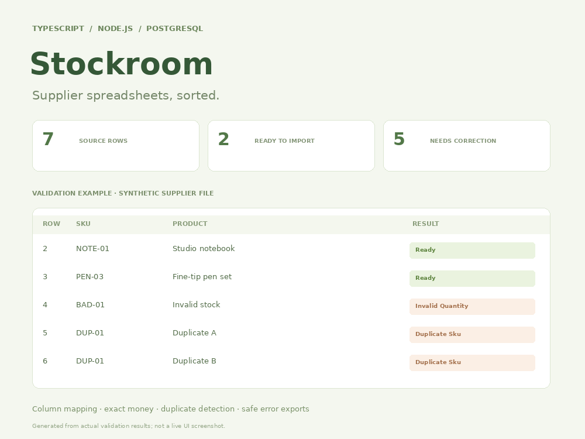

# Stockroom — Supplier inventory importer



A Node.js/TypeScript application that turns supplier CSV and value-based Excel files into a validated, auditable inventory update. Includes column mapping, a dry-run preview, duplicate detection, exact monetary parsing, explicit stock rules, safe error exports, background processing, and import history.

PostgreSQL stores uploads, immutable import snapshots, inventory, and before/after changes. PostgREST exposes narrowly granted transactional RPCs on the internal Docker network. There are no application runtime npm dependencies; the Node standard library handles HTTP, ZIP inflation, and cryptography.

## Run

```bash
cd inventory-import
cp .env.example .env
docker compose up --build -d
```

Open **http://localhost:8091**. Default workspace token: **stockroom-local-admin**.

The browser guides you through:

1. **Upload:** choose a file, drag/drop it, or try the synthetic CSV/XLSX examples.
2. **Map:** select a worksheet, supplier, business reference, stock rule, currency/date defaults, and source columns.
3. **Review:** inspect proposed creates, updates, unchanged rows, older snapshots, and errors. Download an error report if needed.
4. **Confirm:** import all validated rows. If any rows are invalid, explicitly choose valid-only import or correct the source and reupload.
5. **Inspect:** review completed imports and their before/after changes, or search the resulting inventory.

Only the API port is published, bound to localhost. PostgreSQL and PostgREST remain private. The Node containers run as non-root users with read-only filesystems; uploads are normalized into PostgreSQL, not written into the web directory.

## Stock and identity rules

- Inventory identity is **supplier + normalized SKU**. SKUs are trimmed and uppercased. Different suppliers may use the same SKU.
- Supplier names are whitespace-normalized and case-insensitive for identity. References are trimmed and uppercased.
- **Replace** uses the row's quantity as the current stock count. Older effective-date snapshots cannot replace newer stock.
- **Add** treats the row quantity as a new delivery. An older delivery still adds its units but preserves newer product name/price metadata.
- The **supplier reference is the business idempotency key**. Repeating the same source content, reference, and import settings returns the existing batch without applying stock again. Changed content/settings under that reference is a visible conflict.
- A different reference represents a genuinely new delivery, even if the file bytes are identical. Do not invent new references merely to get past a conflict; that can add stock a second time.
- Currency never changes implicitly. A SKU in USD cannot be updated by an EUR row without a separate, explicit conversion workflow outside this MVP.
- Same-day replacement snapshots are applied in processing order. This MVP has date-level freshness, not supplier timestamp/version sequencing.

## Validation and preview

Required columns: SKU, product name, quantity, and unit price. Currency and effective date are optional columns that can use batch defaults. Column suggestions recognize common names such as Product code, Description, On hand, and Unit cost.

- Quantities: non-negative integers up to 1,000,000.
- Prices: non-negative decimal text, converted exactly using integer arithmetic. No float rounding, grouping commas, currency symbols, or exponent notation.
- Supported currencies: USD/EUR/GBP/GEL (2 decimal places), JPY (0), KWD (3).
- Dates: actual ISO `YYYY-MM-DD` dates between 1900 and 2100.
- Duplicate SKUs within the selected sheet invalidate **all** occurrences. The importer does not silently choose a winner.
- Product names are whitespace-normalized. Formula-like prefixes are rejected.
- Each error identifies its source row and field. Reports include original cells and prevent spreadsheet formula execution by escaping dangerous prefixes.

Preview is a read-only estimate against current inventory. Confirmation recomputes validation server-side; it never trusts client-supplied normalized rows. The worker checks inventory again inside its transaction. If a new conflict appears in a strict batch, all its stock writes roll back and the batch fails. In explicitly valid-only mode, conflicting rows are retained as rejected outcomes while the remaining rows apply.

## File support and limits

- UTF-8 `.csv`, with optional BOM, comma/semicolon/tab delimiter detection, quoted separators, escaped quotes, CRLF/LF, and multiline quoted cells.
- Value-based `.xlsx` worksheets with shared strings, rich/inline text, numeric cells, and standard stored/deflated ZIP members.
- A bounded, deliberately limited OOXML reader is implemented in `server/parser.ts`; it is not a complete Excel calculation/formatting engine.
- Formulas are never evaluated; a formula or Excel error flags the source row. Paste values before importing calculated columns.
- Dates must be ISO text. Excel numeric date serials are not interpreted from style information.
- Legacy `.xls`, macros, encrypted/ZIP64/multi-volume archives, external workbook relationships, and external links are unsupported.
- No XML DTD/entity expansion or external network/file resolution occurs. ZIP paths, checksums, sizes, and compression methods are checked.
- Maximum 5 MiB uploaded file, 20 MiB expanded workbook, 5 non-empty sheets, 2,000 data rows per selected sheet, 40 columns, and 1,000 characters per cell. XML depth/node counts and ZIP member counts are bounded.
- The first non-empty row is the header. Headers must be unique and non-empty. Merged layouts, formatting-only templates, arbitrary financial spreadsheets, and multi-header reports should be flattened before upload.

The sample `.xlsx` was constructed independently using Python's standard-library ZIP writer and OOXML components. Python is fixture-generation tooling, not an application dependency. No actual Microsoft Excel UI compatibility test is claimed.

## Background processing and transactional safety

The API stores source data and queues a batch snapshot. A separate Node worker claims it with a lease token. PostgreSQL applies the entire selected batch in one transaction, records row outcomes, and saves before/after inventory changes.

- Supplier/reference uniqueness prevents duplicate imports before a worker runs.
- A worker completion requires the current unexpired lease.
- Expired jobs can be reclaimed up to three times; an exhausted lease moves to Failed.
- Once a batch has committed, retrying its apply RPC cannot add stock again.
- A lost HTTP acknowledgement after the PostgreSQL commit still leaves the batch Completed; the worker cannot replay a committed batch as new work.
- A strict apply failure leaves no partial stock writes. Failed batches can be retried from the details view.
- Concurrent imports for one supplier are serialized. Different suppliers can process independently.

Upload parsing is synchronous and bounded. Applying stock changes runs in the worker. This is a local small-business MVP, not a streaming million-row ETL system.

## Inspecting and exporting

Inventory is paginated in 50-product pages. Import history shows the most recent 100 batches. The review table shows 50 source rows per page. Batch detail displays up to 100 outcomes and changes while the complete row snapshot remains saved in PostgreSQL. Downloaded error CSVs include all invalid rows, not just the visible page.

Raw upload bytes are not retained; parsed sheet values, a content hash, and the original filename are saved. This MVP has no delete/reset UI. Schema files initialize only a new database volume; later schema changes require explicit migrations.

## Tests and development

```bash
npm ci
npm run build
npm test
```

The Node test files exercise CSV/ZIP/OOXML parsing, money/date validation, duplicates, mapping, formula-safe reports, dry-run behavior, authentication, explicit partial opt-in, server-side revalidation, and worker RPC fencing. No socket binding is needed for those tests.

Full Docker build:

```bash
docker compose build api
```

Database assertions, with worker stopped in a development stack:

```bash
docker compose stop worker
docker compose exec -T db psql -U postgres -d stockroom -v ON_ERROR_STOP=1 < tests/database.sql
docker compose up -d worker
```

Real HTTP smoke test:

```bash
docker compose exec -T api node scripts/smoke.mjs
```

It verifies actual CSV/XLSX uploads, preview, partial opt-in, duplicate prevention, additive stock, conflicting references, stale snapshots, and downloadable errors. It creates a uniquely named synthetic supplier and leaves its records for inspection.

The included GitHub Actions workflow builds the image, executes the database assertions, and runs that smoke test. [GitHub Actions run 44304700108](https://github.com/TechiLoki/stockroom/actions/runs/44304700108) passed the complete build, PostgreSQL assertions and real HTTP import workflow. See VALIDATION.md for the tested source commit and remaining UI/Excel-application limits.

## API

All `/api/*` routes require a signed HttpOnly/SameSite session or `Authorization: Bearer ADMIN_TOKEN`, except login. Browser writes also require a same-origin request and `X-Stockroom-Request: 1`.

| Method | Route | Purpose |
| --- | --- | --- |
| POST | `/api/login`, `/api/logout` | Workspace session |
| GET | `/api/overview` | Inventory/import counts and worker heartbeat |
| POST | `/api/uploads?filename=...` | Raw file body; parse and store immutable upload |
| POST | `/api/preview` | `{upload_id, config}` read-only validation |
| POST | `/api/commit` | `{upload_id, config, allow_partial}` queue batch |
| POST | `/api/preview-errors` | Download pre-import error CSV |
| GET | `/api/inventory?search=&supplier=&offset=0` | Current stock |
| GET | `/api/batches` | Import history |
| GET | `/api/batches/{uuid}` | Saved rows, outcomes and changes |
| GET | `/api/batches/{uuid}/errors` | Full invalid-row CSV |
| POST | `/api/batches/{uuid}/retry` | Retry a failed batch |
| GET | `/api/samples/supplier-demo.csv` or `.xlsx` | Synthetic sample files |
| GET | `/healthz`, `/readyz` | Process/database readiness |

## Deployment scope

This is a single-user local workspace. Public deployment needs a proper account/authorization model, TLS, resource controls, and an explicit data-retention policy. Keep the localhost binding and replace development credentials before any exposure. The raw-table schema is not exposed through PostgREST; the app role receives execution rights only on the transactional API schema.

Database passwords in `.env` should be URI-safe because Compose uses a PostgreSQL connection URI. Editing environment variables does not rotate passwords on an existing PostgreSQL volume.

## Format references

- [SpreadsheetML workbook/worksheet structure](https://learn.microsoft.com/en-us/office/open-xml/spreadsheet/structure-of-a-spreadsheetml-document)
- [Shared string tables](https://learn.microsoft.com/en-us/office/open-xml/spreadsheet/working-with-the-shared-string-table)
- [Cell value and formula types](https://learn.microsoft.com/en-us/dotnet/api/documentformat.openxml.spreadsheet.cell)
